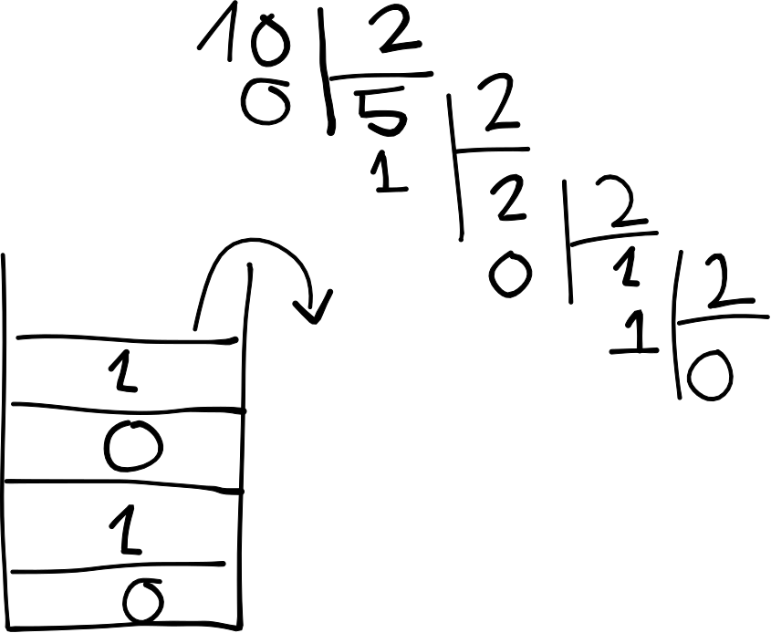
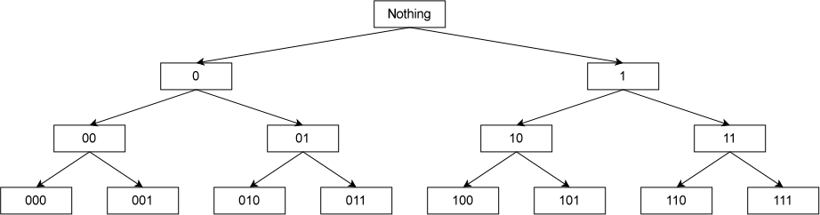

# Recursion

Recursion in C++ is a technique in which a function calls itself directly or indirectly in order to solve a particular problem (often the hard ones). Each recursive call creates a new stack frame and pushes it into the **call stack**, and the fact that it keeps calling itself indefinitely would cause the stack to exhausted; hence, there exists the term **stack overflow**. Therefore, a **base case** (or termination case or trivial output) comes in to prevent the problem, there could be many termination cases in some problems. When the base case is reached, the function returns, its stack frame is automatically removed from the call stack in **LIFO** order, until execution returns to the original caller.

## How recursion works on Call Stack

Try running this code and imagine it in your mind nerd!

```cpp
void count_down(int count)
{
    std::cout << "push " << count << '\n';

    if (count > 1) // termination condition
        count_down(count - 1);

    std::cout << "pop " << count << '\n';
}
```

Once compiled, the **call stack** would look like this:

```cpp
// INput 5 for example
count_down(1);
count_down(2);
count_down(3);
count_down(4);
count_down(5);
main();
```

## Sum of natural numbers

```cpp
int sum_to(int n)
{
    if (n <= 0) return 0;
    if (n == 1) return 1;

    return sum_to(n - 1) + n;
}
```

## Recursive algorithms

A recursive algorithms basically find the solution to the first sub-probem inside a problem and modify it to find the rest of the sub-problem in order to reach a solution.
> For example: in the sum_to() function above solve the sum_to(val - 1) and then adds it to another n to find the solution to sum_to(val).

## Fibonacci numbers

Fibonacci numbers are defined mathematically as:
F(n) = 0 if n = 0
F(n) = 1 if n = 1
F(n) = f(n - 1) + f(n - 2) if n > 1

```cpp
int fibonacci(int count)
{
    if (count == 0) return 0; // base case
    if (count == 1) return 1; // base case
    // if (count > 1) 
    return fibonacci(count - 1) + fibonacci(count - 2);
}
```

## Memoiaztion algorithms

The above recursive Fibonacci algorithm isn’t very efficient, in part because each call to a Fibonacci non-base case results in two more Fibonacci calls. This produces an exponential number of function calls (in fact, the above example calls fibonacci() 1205 times!). There are techniques that can be used to reduce the number of calls necessary. One technique, called memoization, caches the results of expensive function calls so the result can be returned when the same input occurs again.

```cpp
#include <iostream>
#include <vector>

int fibonacci(std::size_t count)
{
    static std::vector results{0, 1};

    if (count < std::size(results)) return results[count];
    results.push_back(fibonacci(count - 1) + fibonacci(count - 2));
    return results[count];
}
```

## Types of recursion

1. Linear
2. Backtracking
3. Binary Tree

## Some practical problems

### 1. Factorial

```cpp
int factorial(int count)
{
    if (count == 0) return 0;
    if (count == 1) return 1;
    return factorial(count - 1) * count;
}
```

### 2. Sum of Digits

```cpp
int sum_digits(int n)
{
    if (n < 10) return n;
    return sum_digits(n / 10) + n % 10;
}
```

### 3. Binary converter



Ordinarily, we do

```cpp
void print_binary(int n)
{
    if (n == 0) return;
    print_binary(n / 2);
    std::cout << n % 2;
}
```

Binary converter handling the 0 and negative cases:

```cpp
void print_binary(unsigned int n)
{
    if (n > 1) print_binary(n / 2);
    std::cout << n % 2;
}
```

### 4. Binary printer

Check out this diagram: 

```cpp
void generate_bin(std::string current, int n)
{
    if (current.length() == n)
    {
        std::cout << current << '\n';
        return;
    }
    generate_bin(current + "0", n);
    generate_bin(current + "1", n);
}
```

### 5. Binary - Octal - Hexadecimal converter

```cpp
#include <iostream>

void print_conversion(long soHe10, int heCoSoMoi = 0)
{
    int base;
    const char digits[] = "0123456789ABCDEF";

    switch (heCoSoMoi)
    {
        case 0: base = 2; break;
        case 1: base = 8; break;
        case 2: base = 16; break;
    }

    if (soHe10 < base)
    {
        std::cout << soHe10;
        return;
    }

    print_conversion(soHe10 / base, heCoSoMoi);
    std::cout << digits[soHe10 % base];
}
```

### 6. LASTNUM

Consult it here: [LASTNUM](../../../UPCODE/LapTrinhNangCao/LASTNUM.cpp)

```cpp
int another_sum(int n)
{
    if (n < 10) return n;

    int sum = 0;
    while (n > 0)
    {
        int digit = n % 10;
        sum += digit;
        n /= 10;
    }
    return another_sum(sum);
}
```

### 7. Cosine and Sine equations

Consult it here: [[LTNC]Final01](../../../UPCODE/LapTrinhNangCao/[LTNC]Final01.cpp)

```cpp
double sine(double x, double n = 10)
{
    if (n == 0) return x;
    return sine(x, n - 1) + std::pow(-1, n) * (pow(x, 2*n+1) / factorial(2*n+1));
}

double cosine(double x, double n = 10)
{
    if (n == 0) return 1;
    return cosine(x, n - 1) +std::pow(-1, n) * (pow(x, 2*n) / factorial(2*n));
}
```

### 8. 
