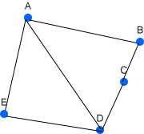
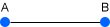
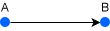
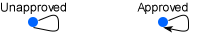
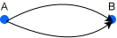
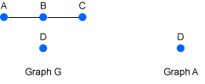
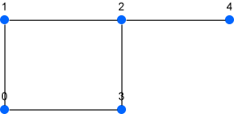
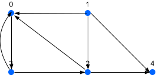

# Graph Theory

## Basic concepts

- Graph theory is basically a branch of mathematics.
- A graph consists of nodes (or vertices) connected by edges (arcs).
- Components of a graph could be any vertices or edges, and other things

## Components

A graph is a combination of vertices and edges which represent the connections between vertices. Here is how it is represented in a mathematical expression:
$$
G = (E, V)
$$
Where:

- G stands for Graph
- E stands for Edges
- V stands for Vertices (*Fact: singular form of vertices is vertex*)

Supposed a graph has these vertices: A, B, C, D, E  
  
A set of vertices in a graph is represented like so
$$
V = {A, B, C, D, E}
$$
While a set of **undirected edges** in a graph is represented similarly
$$
E = \{\{A, B\}, \{B, C\}, \{C, D\}, \{D, E\}, \{D, A\}, \{E, A\}\}
$$
A set of **directed edges** is represented:
$$
E = \{(A, B), (B, C), (C, D), (D, E), (D, A), (E, A)\}
$$

### Vertex

- A simple object in a graph
- A vertex (or node) can be represented as letter (A, B, C) or number (0, 1, 2, 3)

### Edges

- Edges are connect vertices. Some graphs are **directed**, some are **undirected**. (directed or undirected edges in some sources).
- Two vertices are `adjacent` if there is an edge between them.

  
Undirected edge: an edge between A and B can be traversed in either direction. (unordered pair of vertices)

  
Directed edge: A &rarr; B does not imply B &rarr; A (Directions are specified)

#### Self-loop

- A node directed to itself is called a self-loop.
- In undirected graph, self-loop is not allowed.
- In directed graph, self-loop is generally allowed `unless` specified otherwise.

#### Parallel edges

Multiple distinct edges connecting the same pair of vertices.

## Standard Terminology

- a `path` is a sequence of one or more nodes such that any two consecutive nodes in the sequence are adjacent.
  - The `length` of the path $v_1, v_2, ..., v_n$ is $n - 1$
- a `cycle` is a path from a node (any nodes) back to itself (By convention a cycle cannot have the length zero)
- a `simple path` is a path that does not repeat any vertices or edges.
- a `simple cycle` is a path that does not repeat any vertices or edges except the first and the last node.
- Two graphs are `connected` when there is a path between them.

## Connectivity

- Reflexiveness
- Symmetry
- Transitivity

### Connected Components

- Connected components are maximal `group of vertices` in which every vertex can reach every other vertices.
- A `connected graph` with at least on vertex has at least one connected component
- A `disconnected graph` has two or more connected components
  - Within a disconnected graph, there could be a vertex that forms a component of its own; hence it is called an isolated vertex (don't mistake it with a graph containting only one vertex)  

### Directed Connectivity

- Strongly connected
- Weekly connected

  
The illustration above depicts Graph G as a disconnected graph with connected components A B C and isolated vertex D. Graph A contains vertex D, the only connected component in the graph.

## Degree

The degree of vertex is the number of edges incident to that vertex.  
  
In the illustration above:

- A, D has the degree of 3 since there are 3 edges incident to them.
- B, C, E  has the degree of 2

However, for `directed graph`, the degree of a vertex comprises two definitions:

- `in-degree` represents edges that direct to (point to) the vertex.
- `out-degree` represents edges that direct from the vertex.

## Adjacency in Graph

### Adjacency matrix

An adjacency matrix is a square matrix representing whether pairs of vertices in a graph are adjacent. If a graph has V set of vertices, the size of the matrix will be V x V.

In other words, adjacency matrix is a way to represent a finite graph in a computer, or more specifically, programming languages.

1. Unidrected and unweighted graph
2. Directed and unweighted graph
3. Undirected and weighted graph
4. Directed and weighted graph

An instance of `Undirected and unweighted graph`  
Given graph $G = (V, E)$:  

| |0|1|2|3|4|
|-|-|-|-|-|-|
|0|0|1|0|1|0|
|1|1|0|1|0|0|
|2|0|1|0|1|1|
|3|1|0|1|0|0|
|4|0|0|1|0|0|

Notice that it is symmetric $A[i][j] = A[j][i]$

Here's how I interpret the matrix:

- $A[i][j] = 1$ when node i adjacent to node j
- $A[i][j] = 2$ when there is no edge between them.

An instance of `Directed and unweighted graph`:  
  

| |0|1|2|3|4|
|-|-|-|-|-|-|
|0|0|0|0|1|0|
|1|1|0|1|0|1|
|2|1|0|0|0|1|
|3|1|0|1|0|0|
|4|0|0|0|0|0|

Notice that it isn't NECESSARILY symmetric.

Here's how I interpret the matrix:

- $A[i][j] = 1$ if there is a directed edge directed from i to j
- $A[i][j] = 0$ if there isn't so

### Adjacency list

An adjacency list is a data structure used to represent a graph where each vertex stores its neighbouring vertices

Similar to adjacency matrix, the representation of adjacency list for a graph varies depending on the directive and the complexity of the graph (weighted or unweighted):

1. Undirected graph
2. Directed graph
3. Undirected and weighted graph
4. Directed and weighted graph

For instance, an adjacency list for the previous `undirected graph`:  
  

|Vertex|Neighbours|
|-|-|
|0|1, 3|
|1|0, 2|
|2|1, 3, 4|
|3|0, 2|
|4|2|

Another instance for `directed graph`:  

|Vertex|Neighbours|
|-|-|
|0|3|
|1|0, 2, 4|
|2|0, 4|
|3|0, 2|
|4|Desolated|

## Types of Graphs

## Common vocabulary

- Graph, Edges, Vertices
- Directed / Undirected Graph
- Path
- Degree
- Level
- Cycle
- incident (adj): touching or hitting a surface (e.g. incident edges)
- adjacent (adj): next to something (the pair of vertices is adjacent)
